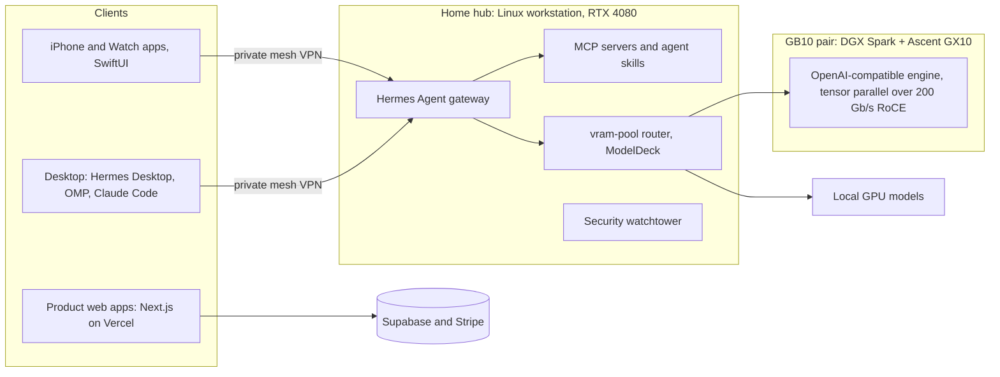

# Tanner Osterkamp

Founder of [Kodros](https://kodros.ai). Firefighter-paramedic in Orange County, California.

I build private AI that runs on hardware you own: a home inference cluster, the agents and MCP servers on top of it, and the iPhone, web and desktop apps people use to reach it. I also build public-safety software, including EMS protocol search for medics.

## The Kodros stack

Phones and desktops talk to one hub over a private VPN. The hub runs the agent gateway, MCP tools and a router that picks which machine serves each model. The big model runs across two GB10 machines, so the agent path needs no hosted model. The product sites run separately on Vercel with Supabase and Stripe.

## Public repositories

| Repo | What it is |
|---|---|
| [kodros-vram-pool](https://github.com/thefiredev-cloud/kodros-vram-pool) | One OpenAI-compatible endpoint in front of every machine with GPU memory, with failover and a hot-swap slot. Rust. |
| [kodros-gb10-deepseek-tp2](https://github.com/thefiredev-cloud/kodros-gb10-deepseek-tp2) | DeepSeek-V4.1-Flash (a China-origin model) across a DGX Spark and an Ascent GX10: settings, watchdogs and measured throughput. |
| [kodros-modeldeck](https://github.com/thefiredev-cloud/kodros-modeldeck) | Local model fleet dashboard with a three-check gate on cluster model swaps. Python. |
| [kodros-openai-endpoint-bench](https://github.com/thefiredev-cloud/kodros-openai-endpoint-bench) | One Python file that times a streaming OpenAI-compatible endpoint: first token, prefill and decode speed, two-stream throughput. |
| [kodros-localclip](https://github.com/thefiredev-cloud/kodros-localclip) | Short-clip maker that transcribes, picks moments with a local LLM, crops to faces and adds captions. Runs on your own GPU or CPU. |
| [kodros-localavatar](https://github.com/thefiredev-cloud/kodros-localavatar) | Talking-head video maker: one photo and a script in, a captioned MP4 out, all on your own GPU. Python. |
| [kodros-localbolt](https://github.com/thefiredev-cloud/kodros-localbolt) | Prompt-to-web-app builder that runs against a local model server, with versions and a sandboxed preview. Python. |
| [kodros-lattice-wildfire](https://github.com/thefiredev-cloud/kodros-lattice-wildfire) | Five wildfire apps on Anduril's Lattice SDK: public fire feeds, fusion, recon planning, local-model briefs. Python. |
| [kodros-mac-cu](https://github.com/thefiredev-cloud/kodros-mac-cu) | Swift CLI that lets an AI agent click, type and read any Mac app through the accessibility tree. |
| [kodros-orb](https://github.com/thefiredev-cloud/kodros-orb) | macOS floating panel for talking to the Pi coding agent, sharing your screen and running commands. Swift. |
| [kodros-chromectl](https://github.com/thefiredev-cloud/kodros-chromectl) | One-file CLI that lets an agent drive Chromium over loopback DevTools, with safety rules. |
| [kodros-sec-edgar-mcp](https://github.com/thefiredev-cloud/kodros-sec-edgar-mcp) | Read-only MCP server for SEC filings; every number cites its filing. |
| [kodros-search-console-mcp](https://github.com/thefiredev-cloud/kodros-search-console-mcp) | MCP server for Google Search Console with confirm-gated writes and a state-checked OAuth sign-in. |
| [kodros-moa-architecture](https://github.com/thefiredev-cloud/kodros-moa-architecture) | Written reference for a multi-agent design with one accountable agent and a human approval gate. Documentation only. |
| [agent-ops-kit](https://github.com/thefiredev-cloud/agent-ops-kit) | Claude Code plugin: evidence before claims, and a scanner that fails a build when private data is left in. |
| [eufy-camera-mcp](https://github.com/thefiredev-cloud/eufy-camera-mcp) | MCP server with view-only access to an allowlist of local cameras. |
| [omarchy-doctors](https://github.com/thefiredev-cloud/omarchy-doctors) | Four read-only diagnostics for an Omarchy desktop: display lag, input, bar plugins and Quickshell crashes. |
| [omarchy-ai-token-bar](https://github.com/thefiredev-cloud/omarchy-ai-token-bar) | Two Omarchy bar widgets that count AI tokens from local agent logs and from a local model cluster. |
| [omarchy-deck](https://github.com/thefiredev-cloud/omarchy-deck) | Omarchy Deck source: iOS app, MCP server and web view. Being published; the link works once the repo is public. |
| [kodros-bot](https://github.com/thefiredev-cloud/kodros-bot) | Self-hostable bot app on Hermes Agent, one computer per bot. Fork of Rakazo. |

Also: [airpods-max-sidetone](https://github.com/thefiredev-cloud/airpods-max-sidetone) (PipeWire sidetone for AirPods Max), [reach-plugins](https://github.com/thefiredev-cloud/reach-plugins) and [reach-plugins-registry](https://github.com/thefiredev-cloud/reach-plugins-registry) (Reach SSH client), and forks of [Reach](https://github.com/thefiredev-cloud/Reach) and [hermes-agent](https://github.com/thefiredev-cloud/hermes-agent), where upstream is canonical.

## Products

- [Kodros](https://kodros.ai): your business on a server you own, with AI agents that ask a named person before anything is sent, paid, posted or changed. iPhone app in TestFlight beta.
- [Protocol Guide](https://protocol-guide.com): EMS protocol search by county. Every answer names its protocol book. Education and reference only.
- [JudgeFinder](https://judgefinder.io): federal judge and docket search on public CourtListener data. Not legal advice.
- [AmpHours](https://apps.apple.com/us/app/amphours-battery-runtime/id6819963364): offline battery runtime calculator for iPhone, on the App Store.

Product source for these stays private. The full list with status is in the [portfolio](https://github.com/thefiredev-cloud/.github/blob/main/profile/README.md).

## Contact

[tanner@kodros.ai](mailto:tanner@kodros.ai) · [LinkedIn](https://www.linkedin.com/in/tannerosterkamp) · Security reports: [SECURITY.md](SECURITY.md)
