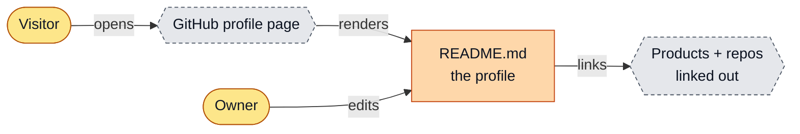
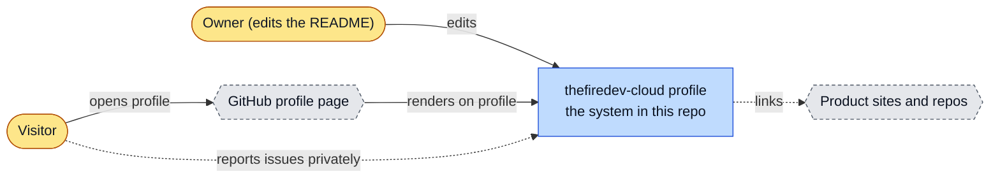
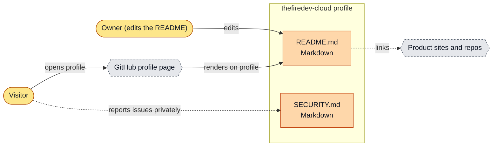
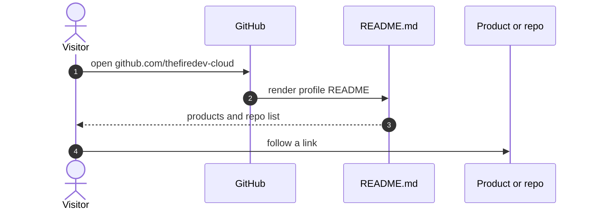

# thefiredev-cloud profile: architecture

<!-- arch-kit:generated -->

> Whiteboard-level structure: what systems exist, what they talk to, and when they run. Evidence-backed; every box below maps to a path listed in [Evidence](#10-evidence).
> Generated by the ArchDocs kit from repo commit `9eb46e0fe7`. Diagram sources: [`architecture/*.mmd`](architecture/). Hi-res renders sit next to each source.

## 1. Purpose

This is the special profile repository whose `README.md` GitHub renders on the thefiredev-cloud profile page. It has no code. It introduces the founder, lists the products (Mesh, the one-week install, Protocol Guide, JudgeFinder, MeshVault Harness, TheFireDev) with their current status, and groups the public repositories by topic. `SECURITY.md` tells people how to report a vulnerability privately.

## 2. Whiteboard view

Five boxes. One rendered file points at everything else.

Hi-res: [SVG](architecture/whiteboard.svg) · [PNG 3x](architecture/whiteboard@3x.png) · [dark SVG](architecture/whiteboard.dark.svg) · [dark PNG 3x](architecture/whiteboard.dark@3x.png)

Explorable version (Archify, standalone HTML, download and open locally): [`architecture/thefiredev-cloud.archify.html`](architecture/thefiredev-cloud.archify.html)

## 3. System context (C4 level 1)

Who and what touches the system from outside.

Hi-res: [SVG](architecture/context.svg) · [PNG 3x](architecture/context@3x.png)

## 4. Containers and components (C4 level 2)

The parts that run or hold data inside the repo's system boundary.

Hi-res: [SVG](architecture/containers.svg) · [PNG 3x](architecture/containers@3x.png)

| Container | Kind | Tech | What it does | Evidence |
|---|---|---|---|---|
| README.md | doc | Markdown | Founder intro, products with status date, what I work on, grouped public repositories. | [`README.md#L1-L33`](../README.md#L1-L33) |
| SECURITY.md | doc | Markdown | Private vulnerability reporting instructions. | [`SECURITY.md`](../SECURITY.md) |

## 5. Key runtime sequences

### 5.1 A visitor reaches a product

Hi-res: [SVG](architecture/sequence-1.svg) · [PNG 3x](architecture/sequence-1@3x.png)

## 6. Data flow and stores

No data store. The README is the only content, and its product status carries an explicit date (`status as of 2026-10-09`).

## 7. Deployment and runtime topology

Nothing is deployed. GitHub renders the file on the profile page. There is no CI and no schedule, so the status text goes stale until the owner edits it.

## 8. Failure modes and how to see them

| Failure | What the user sees | How to see it | Evidence |
|---|---|---|---|
| Product status text goes stale | Visitors see old status | The section header carries a date; compare it to today | [`README.md#L7`](../README.md#L7) |
| A linked repo is renamed or made private | Dead link on the profile | Manual check; no link checker | [`README.md#L22-L33`](../README.md#L22-L33) |

## 9. State machine

No state machine in this repo: it is one static page.

## 10. Evidence

Every path below exists at the pinned commit; links are relative to `docs/`.

| Path | Why it matters |
|---|---|
| [`README.md#L1-L33`](../README.md#L1-L33) | Intro, products with status date, public repositories. |
| [`SECURITY.md`](../SECURITY.md) | Private vulnerability reporting. |
| [`LICENSE`](../LICENSE) | MIT. |

Graphify (local AST, no LLM) read this repo: 11 nodes, 10 edges, 3 communities. Most connected: `Tanner Osterkamp` (5), `Security policy` (4), `Products (status as of 2026-10-09)` (1), `What I work on` (1), `Public repositories` (1).

- Report: [`architecture/graphify/GRAPH_REPORT.md`](architecture/graphify/GRAPH_REPORT.md)
- Interactive graph: [`architecture/graphify/graph.html`](architecture/graphify/graph.html) (27 KB, download and open locally)
